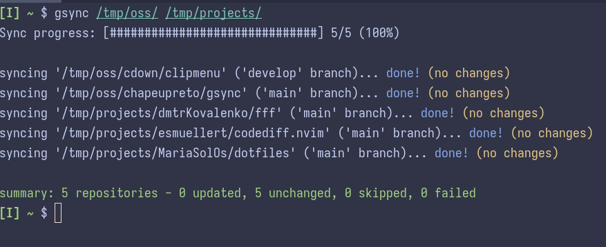

`gsync` - a tool that recursively synchronizes the default branch for one or more git repositories



# About

Suppose you have under your `~/code/` directory a structure like the one below:

```sh
├── awesome-project-1/
├── awesome-project-2/
├── awesome-project-3/
├── pet-project-1/
└── pet-project-2/
```

Now, you'd like to make sure all those projects have their local `main` (or `master`) git branch updated with the latest changes from the corresponding branch on the remote.
Instead of entering each one of those directories and then issuing a command like `git pull <remote> main`, you can just do `gsync ~/code/`
(or `gsync .` in case your current working directory is already `~/code/`) and gsync will perform that operation for you, recursively.

This "synchronization" (i.e., `git pull`) action only works if the git project being synchronized has exactly 1 remote configured.
Up to five repositories are synchronized concurrently; a progress bar tracks completed repositories while the sync is running. Their results are displayed in directory traversal order once synchronization completes.

The default branch name (i.e, `master`, `main`, etc) is determined by the tool from the configured remote; its name does not need to be `origin`.
Also, `gsync` will not mess your git repository in case it is in a state considered "dirty" (i.e., `git status` identified uncommitted changes).

# Requirements

- [Git](https://git-scm.com/)
- [Bash](https://www.gnu.org/software/bash/), version 5.1 or newer
- [wc](https://www.gnu.org/software/coreutils/wc) - available on every Linux distro

# Installation

`gsync` is installed to `$HOME/.local/bin/`, which must exist and be defined on your shell `PATH` so the `gsync` command can be invoked from anywhere.

Make sure `$HOME/.local/bin/` exists and is on your `PATH` before installing:

```sh
mkdir -vp $HOME/.local/bin
```

If `$HOME/.local/bin/` is not yet on your `PATH`, add the following line to your shell configuration file (`~/.bashrc` for Bash or `~/.zshrc` for Zsh):

```sh
export PATH=$HOME/.local/bin:$PATH
```

For Fish, whose syntax differs, add the following line to `~/.config/fish/config.fish` instead:

```fish
fish_add_path $HOME/.local/bin
```

Then, restart your shell (or run `source ~/.bashrc`, `source ~/.zshrc` or `source ~/.config/fish/config.fish`, depending on your shell) so the new `PATH` takes effect. Note that `fish_add_path` stores the change persistently, so Fish picks it up automatically in new sessions.

Finally, install `gsync`:

```sh
git clone https://github.com/chapeupreto/gsync
cd gsync
chmod +x gsync
cp -vip gsync $HOME/.local/bin/gsync
```

You can verify the installation worked by running:

```sh
gsync --version
```

# Usage

```sh
gsync [<directory-path>]
```

When no argument is given, `gsync` uses the current working directory by default; otherwise the `<directory-path>` is the directory path where your git repositories live in.

`gsync` exits with status `0` when every repository was updated or already up to date, and with status `1` when any repository failed to synchronize or was skipped. When a pull fails, the error reported by git is shown and the repository is left on its original branch (or detached commit).

# Tests

Run the test suite with:

```sh
for test in tests/*.sh; do bash "$test"; done
```

- `tests/parallelism.sh` checks the synchronization concurrency limit and progress bar.
- `tests/failures.sh` checks failure reporting, the exit status, and that a failed synchronization does not change the checked-out branch.
- `tests/detached-head.sh` checks that a detached HEAD is preserved.
